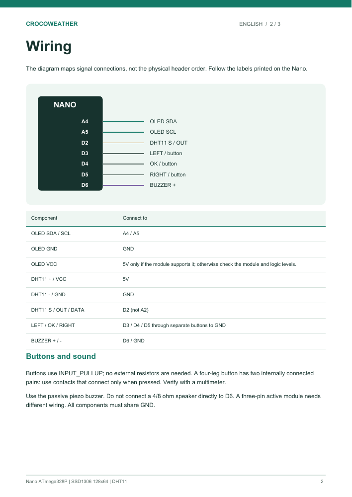

# CrocoWeather

[English](#english) | [Български](#български)

**[Download the assembly guide / Изтегли ръководството за сглобяване (PDF, EN + BG)](output/pdf/CrocoWeather-Assembly-Guide-EN-BG.pdf)**

Parts, breadboard placement, wiring, Arduino IDE setup, and troubleshooting - English first, then Bulgarian.

Части, поставяне на бредборда, свързване, настройки на Arduino IDE и диагностика - първо на английски, после на български.

## English

A combined weather station and crocodile virtual pet for the Arduino Nano ATmega328P with a monochrome 0.96″ 128×64 SSD1306 I²C OLED display.

### Features

- Main menu: weather station, virtual pet, and SOUND OFF/ON.
- DHT11: temperature, humidity, and minimum/maximum temperature.
- LIVE indicates a successful latest reading; STALE shows the last valid reading and its age after a failed read.
- A crocodile that eats laptops and phones, with fullness, happiness, and sleep.
- Animations: blinking, tail and foot movement, approaching food, chewing, crumbs, and sleep.
- Sound effects only in pet mode; sound is off by default at startup.
- Return to the menu by holding the left and right buttons together for 1.5 seconds.

### Files

- [Bilingual assembly guide (PDF)](output/pdf/CrocoWeather-Assembly-Guide-EN-BG.pdf) - illustrated assembly and first checks, English and Bulgarian.

- `CrocoWeather/CrocoWeather.ino` — the main application.
- `CrocoWeather/README_BG.md` — detailed instructions in Bulgarian.
- `HardwareCheck/HardwareCheck.ino` — a standalone DHT11 test without display updates or sound generation.

### Wiring

| Component | Nano |
|---|---|
| OLED SDA | A4 |
| OLED SCL | A5 |
| OLED GND | GND |
| OLED VCC | Follow the module specification; use 5V only if supported |
| DHT11 S/OUT/DATA | D2 |
| DHT11 + / VCC | 5V |
| DHT11 − / GND | GND |
| Left button | Connects D3 to GND when pressed |
| Middle button | Connects D4 to GND when pressed |
| Right button | Connects D5 to GND when pressed |
| Passive piezo buzzer | + to D6, − to GND |

The buttons use INPUT_PULLUP. Follow the labels on the DHT11 module rather than assuming a pin order. Do not connect a low-impedance 4/8 Ω speaker directly to a Nano pin.

### Uploading with Arduino IDE

1. Install Arduino AVR Boards and the libraries U8g2 (2.36.19), DHT sensor library by Adafruit (1.4.7), and Adafruit Unified Sensor (1.1.15).
2. Open `CrocoWeather/CrocoWeather.ino`.
3. Select Arduino Nano, the ATmega328P processor, and the board's port.
4. Click Upload. If the bootloader does not match, try ATmega328P (Old Bootloader).

Use the left/right buttons to select and the middle button to confirm. Enable SOUND in the main menu to hear effects. The pet's needs pause outside pet mode. Progress is not saved when power is disconnected.

### Validation and known issues

The latest version compiled successfully for `arduino:avr:nano:cpu=atmega328` and `arduino:avr:nano:cpu=atmega328old`: 26582 bytes of program storage and 1306 bytes of static RAM. Successful compilation does not guarantee operation of the physical components.

The DHT11 on the current device still returns failed readings; the cause has not been identified. The application retries every 2.5 seconds and reinitializes the sensor after three consecutive failures. `DATA idle=1` alone does not prove correct wiring. Use HardwareCheck and the Serial Monitor at 9600 baud for diagnostics.

Continuous buzzer noise has been reported. The application starts with SOUND OFF and holds D6 low outside sound effects. If buzzing persists, check the hardware. Resolution of this issue on the physical device has not yet been confirmed.

### Different foods and hiccups

- LAPTOP: +30 fullness and +5 happiness. PHONE: +12 fullness and +12 happiness.
- If a portion would exceed 100 fullness, fullness is capped at 100, happiness decreases by 5, and the crocodile hiccups for about 8 seconds after eating.
- Hiccups include a small jump and HIC!, with a short sound only when SOUND is ON.
- Another meal cannot be started while chewing.
- Below 25 fullness, the crocodile looks down toward LAPTOP/PHONE and displays an arrow.
- Sleeping or switching modes stops the hiccups.

---

## Български

Комбинирана метеостанция и тамагочи с крокодил за Arduino Nano ATmega328P и монохромен I²C OLED SSD1306 0,96″, 128×64.

### Функции

- Начално меню: метеостанция, тамагочи и SOUND OFF/ON.
- DHT11: температура, влажност, минимална и максимална температура.
- LIVE за актуално измерване; STALE за последното валидно измерване с неговата възраст.
- Крокодилче, което яде лаптопи и телефони; ситост, настроение и сън.
- Анимации: мигане, опашка и крачета, приближаваща храна, дъвчене, трохи и сън.
- Звук само в тамагочи режима; след включване е изключен по подразбиране.
- Връщане в менюто: задържане на левия и десния бутон за 1,5 секунди.

### Файлове

- [Двуезично ръководство за сглобяване (PDF)](output/pdf/CrocoWeather-Assembly-Guide-EN-BG.pdf) - илюстрирани инструкции и първи проверки на английски и български.

- `CrocoWeather/CrocoWeather.ino` — основното приложение.
- `CrocoWeather/README_BG.md` — подробни инструкции.
- `HardwareCheck/HardwareCheck.ino` — самостоятелен тест на DHT11 без дисплей и без генериране на звук.

### Свързване

| Компонент | Nano |
|---|---|
| OLED SDA | A4 |
| OLED SCL | A5 |
| OLED GND | GND |
| OLED VCC | Според спецификацията на модула; 5V само при поддръжка |
| DHT11 S/OUT/DATA | D2 |
| DHT11 + / VCC | 5V |
| DHT11 − / GND | GND |
| Ляв бутон | D3 към GND при натискане |
| Среден бутон | D4 към GND при натискане |
| Десен бутон | D5 към GND при натискане |
| Пасивен пиезо зумер | + към D6, − към GND |

Бутоните използват INPUT_PULLUP. Следвайте надписите на DHT11 модула, а не предполагаем ред на изводите. Нискоомен говорител 4/8 Ω не се свързва директно към пин на Nano.

### Качване през Arduino IDE

1. Инсталирайте Arduino AVR Boards и библиотеките U8g2 (2.36.19), DHT sensor library от Adafruit (1.4.7) и Adafruit Unified Sensor (1.1.15).
2. Отворете `CrocoWeather/CrocoWeather.ino`.
3. Изберете Arduino Nano, процесор ATmega328P и порта на платката.
4. Качете с Upload. При несъответстващ bootloader опитайте ATmega328P (Old Bootloader).

Ляв/десен избира; средният потвърждава. За звукови ефекти първо включете SOUND от главното меню. Нуждите на животинчето са на пауза извън тамагочи режима. Прогресът не се записва при изключване.

### Проверки и известни проблеми

Последната версия е компилирана успешно за `arduino:avr:nano:cpu=atmega328` и `arduino:avr:nano:cpu=atmega328old`: 26582 байта програмна памет и 1306 байта статична RAM. Компилацията не е гаранция за работа на реалните компоненти.

На текущото устройство DHT11 все още връща неуспешни прочитания; причината не е установена. Програмата прави повторни опити през 2,5 секунди и повторна инициализация след три последователни грешки. `DATA idle=1` само по себе си не доказва правилна връзка. Използвайте HardwareCheck и Serial Monitor на 9600 baud за диагностика.

Съобщавано е постоянно жужене на зумера. Програмата стартира със SOUND OFF и държи D6 ниско извън звуковите ефекти; ако жуженето остане, трябва да се провери хардуерът. Решението на този проблем върху устройството още не е потвърдено.

### Различна храна и хълцане

- LAPTOP: +30 ситост, +5 настроение. PHONE: +12 ситост, +12 настроение.
- Ако порцията надхвърли 100 ситост: ситостта се ограничава до 100,
  настроението пада с 5 и след храненето започва хълцане за около 8 секунди.
- Хълцането има подскачане и HIC!, а кратък звук само при SOUND ON.
- По време на дъвчене не се приема ново хранене.
- Под 25 ситост крокодилът гледа надолу към LAPTOP/PHONE и показва стрелка.
- Сън или смяна на режима прекратяват хълцането.
